  

  
  

---

### 🧑‍💻 About me

  

---

### 🚀 My project

  

---

### 💻 Languages

- 📱 **Kotlin** — Android apps and Jetpack Compose
- 🍎 **Swift** — exploring native iOS development
- 🌐 **TypeScript / JavaScript** — web interfaces, React, Node.js
- 🐘 **PHP** — Laravel-based hosting and billing systems
- 🐍 **Python** — scripting and dev tools
- 🐧 **Bash** — Linux administration and server automation
- ⚙️ **C / ARM64 Assembly** — bootloaders and low-level experiments
- 🔌 **C++** — ESP32 and microcontrollers
- 🗄️ **SQL**, 🎨 **HTML & CSS**

---

### 🛠 Tech stack

- 🖥️ **Infrastructure** — Linux, Debian, Docker, VPS, Pterodactyl, Paymenter
- 🌍 **Web** — React, Laravel, Tailwind CSS, Inertia.js
- 💾 **Databases** — PostgreSQL, Redis
- 📱 **Mobile** — Android Studio, Jetpack Compose, Gradle, iOS
- 🔧 **Embedded** — ESP32, Arduino, Orange Pi, ARM64
- 📡 **Networking** — TCP/IP, DNS, DHCP, Cloudflare
- 🎨 **Design** — Inkscape, SVG, UI/UX

  

---

### 📊 GitHub stats

  

  

  

  

---

### 🐍 Contribution snake

  

